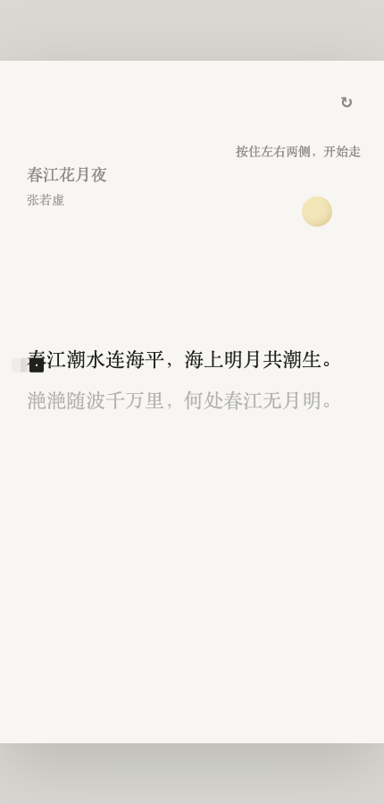

# 字里行间 · 春江花月夜原型

基于 [Edwardxlai/In-the-word](https://github.com/Edwardxlai/In-the-word) 的 fork。原项目将诗词阅读页面变成文字探索游戏。



## 本 fork 的改动范围

- 保留上游根入口、游戏基础与视觉资源。
- 新增独立的《春江花月夜》第二关原型页面及其需求文档。
- 该独立原型尚未接入根入口的完整关卡流程，不能把上游基础功能都视为本 fork 的原创贡献。

## 运行

需要 Node.js 22 或更高版本。

```bash
npm ci
npm run dev
```

根入口为 Vite 输出的地址；独立原型在同一地址下的 `/prototypes/chunjiang/`。例如：

- 上游主入口：<http://localhost:5173/>
- 春江花月夜原型：<http://localhost:5173/prototypes/chunjiang/>

开发服务器使用其他端口时，相应替换 URL 中的端口。

## 构建与预览

```bash
npm run build
npm run preview
```

构建输出为 `dist/`，独立原型会保留在 `dist/prototypes/chunjiang/`。依赖与构建文件由本机生成，不提交到源码仓库。

## 操作与测试范围

根入口的键盘与触屏控制见游戏提示，支持方向键 / A、D 移动，W / 空格跳跃，R 重置。

仓库保留上游的 `npm run smoke` 脚本，它依赖 Windows 本机 Chrome 和已运行的开发服务器，不是跨平台 CI。构建成功不等同于所有关卡已完成浏览器回归测试。

## 目录与来源

```text
src/                           上游关卡与游戏代码
public/prototypes/chunjiang/    本 fork 的独立第二关页面
public/assets/                 游戏运行素材
scripts/                       上游冒烟测试脚本
docs/chunjiang-prd.md          第二关需求文档
```

技术栈：Vite、原生 JavaScript、GSAP、Canvas 和 CSS。根目录的设计文档、素材记录和上游实现继续保留；素材来源见《视觉资源来源记录.md》。

## 独立原型的状态与清理

`public/prototypes/chunjiang/script.js` 在 `CONFIG.triggers` 中集中定义关卡触发位置。`round-tasks.js` 管理一局内的延迟效果、动画回调和自动演示等待；重置会取消旧任务并清空输入，防止上一局修改新一局。未使用的缺口与着色实验代码已移除。

`npm test` 验证旧计时器、动画回调和自动演示的取消行为；该测试已加入 CI。
